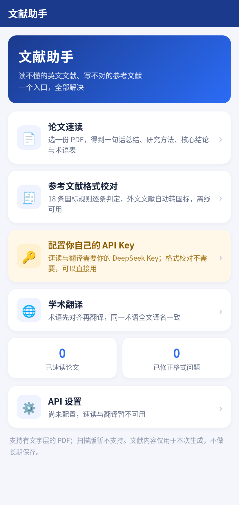
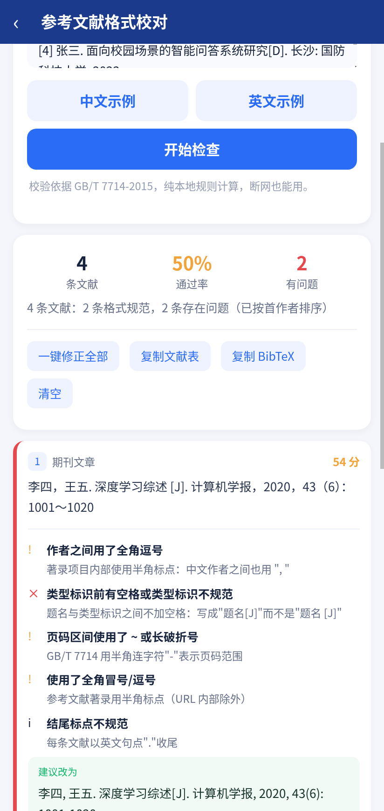
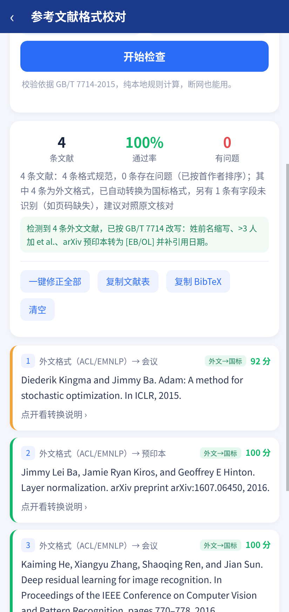
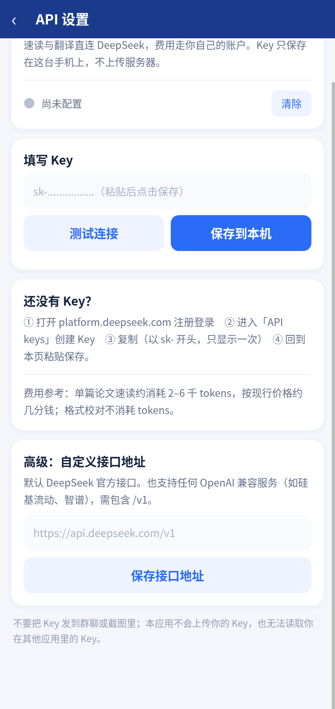

# 文献助手（DocAssist）

面向校园真实场景的 AI 文献工具：**论文阅读（原文 + 速读 + 相似论文 + AI 助手）· 参考文献格式校对 · 学术翻译**。
微信小程序（原生）+ 微信云开发，2026 年 AI 应用创新大赛参赛作品。

## 目录结构

```
docassist/
├── miniprogram/            小程序前端（原生）
│   ├── pages/index         首页（三个入口 + 使用统计）
│   ├── pages/read          论文速读（上传 PDF → 结构化摘要）
│   ├── pages/cite          参考文献格式校对（GB/T 7714-2015 规则引擎）
│   ├── pages/translate     学术翻译（术语先对齐，再逐段翻译）
│   └── utils/gb7714.js     规则引擎副本（由 scripts/sync.js 生成）
├── cloudfunctions/docai/   云函数：PDF 解析 + 大模型调用
├── shared/                 共享核心代码（单一事实来源）
│   ├── gb7714.js           参考文献规则引擎（纯规则，可离线运行）
│   ├── refconvert.js       外文体例识别与转国标（ACL/IEEE → GB/T 7714）
│   ├── preview-core.js     原文预览内核（渲染/选区/高亮/标注存储，Android 与网页共用）
│   ├── search-links.js     相似论文：平台检索链接 + OpenAlex/Crossref 结果归一化
│   ├── library.js          本地论文库（IndexedDB）：保存最近打开的 PDF 与元数据
│   └── docai-core.js       大模型调用、PDF 解析、参考文献段抽取
├── app-android/            Android 客户端（Capacitor 壳，可打包成 APK）
│   ├── src/                页面逻辑 + 原文预览 + AI 助手 + pdf.js 封装 + 浏览器端模型调用
│   ├── www/                前端资源（index.html + esbuild 产物 app.js）
│   └── android/            Capacitor 生成的 Android 工程
├── local-preview/          本地 Web 复刻版（无小程序账号也能演示/自测）
├── test/                   规则引擎与标注存储回归测试
└── docs/                   作品说明书、汇报 PPT、演示脚本
```

## 功能预览

| 首页 | 参考文献格式校对 |
| :---: | :---: |
|  |  |

| 英文文献校对（外文体例转国标） | API 设置（BYOK 自带密钥） |
| :---: | :---: |
|  |  |

## 三步跑起来

### 1. 本地自测（不需要小程序账号）

```bash
git clone https://github.com/JosiahBristow/DocAssist.git
cd DocAssist
npm install
npm run preview             # 浏览器打开 http://127.0.0.1:5178
```

打开后点首页「API 设置」，粘贴你自己的 DeepSeek Key → 测试连接 → 保存（只存浏览器 localStorage）。
不填也能用：格式校对为真实计算，速读/翻译返回示例数据。
（可选）想用 .env 给服务端兜底：`cp .env.example .env` 后填 `DEEPSEEK_API_KEY`。

### 2. 小程序端

1. 微信开发者工具 → 新建项目 → 目录选本仓库根目录（AppID 填自己的；
   没有可先用「测试号」跑通页面，发布体验版必须有自己的 AppID）。
2. 打开「云开发」→ 新建环境（基础版免费）。
3. 右键 `cloudfunctions/docai` → **上传并部署：云端安装依赖**。
4. 云开发控制台 → 云函数 → `docai` → 配置：
   - 超时时间：**60 秒**（默认 3 秒会超时）
   - 环境变量：**不需要配**（作品为 BYOK，密钥由用户在小程序「API 设置」里自填）
     - 只有在团队自测、想给评委留共享额度时才配 `DEEPSEEK_API_KEY`（会用团队额度，慎用）
5. 云开发 → 数据库 → 新建集合 `papers`（可选，仅用于历史记录；不建也能跑）。
6. 点击「预览」→ 手机扫码即用；「上传」→ 版本管理 → 设为体验版，生成体验二维码给评审。

### 3. Android 客户端（APK）

同一份 `shared/` 代码，换个壳就能装到手机上：格式校对离线可用，PDF 解析在本地做，AI 由用户自带的 Key 直连。

```bash
cd ~/Documents/docassist/app-android
npm install                # @capacitor/* + pdfjs-dist + esbuild
node build.js              # shared/ + src/ → www/app.js（含 pdf.js worker）
npx cap sync android       # 同步 web 资源到 Android 工程

# 需要 JDK 17+ 与 Android SDK（platforms;android-34、build-tools;34.0.0）
cd android && ./gradlew assembleDebug
# 产物：android/app/build/outputs/apk/debug/app-debug.apk
```

装到手机：

```bash
adb install -r android/app/build/outputs/apk/debug/app-debug.apk
# 或直接把 apk 拷进手机点击安装（需允许"未知来源"）
```

> Android 端与小程序端的差别：没有云函数、没有数据库。PDF 用 pdf.js 在本机解析（按坐标重建行结构，
> 否则整页挤成一行，"参考文献"标题就定位不到），模型调用走原生 HTTP（CapacitorHttp），不受跨域限制。

### 4. 提交材料

```bash
npm run sync                # 改过 shared/ 后必须执行
```

## 关键设计

- **BYOK（用户自带密钥）**：AI 功能用用户自己的 DeepSeek Key，只存本机；云函数仅在内存中转发，
  不落库、不写日志、异常信息自动抹除密钥。格式校对完全不经过模型，也就不需要任何密钥。
- **规则引擎不依赖大模型**：GB/T 7714 校验有 18 条规则，纯本地计算，秒出结果、断网可用、结果可复现；
  大模型只负责"读不懂"的部分（摘要、翻译），失败不影响格式校对。
- **术语先对齐再翻译**：先抽 12–20 个术语建表，翻译时作为强约束注入，解决同一术语前后译法漂移。
- **PDF → 参考文献联动**：解析时自动定位"参考文献"段落并按编号切分，一键进入格式校对——
  这是学生写课程论文最痛的一步。
- **原文与速读同页（Android / 本地预览网页）**：选一份 PDF 立即渲染原文，速读在后台生成，
  四个 Tab：原文 / 要点 / 结构 / 术语 / 相似。原文支持按钮缩放、双指捏合（1×–3×，桌面 Ctrl+滚轮）、
  划词翻译（走用户自己的 Key，单次调用，不抽术语、不分段）、高亮备注；标注按文件指纹
  （文件名 + 大小 + 内容哈希）存在本机 localStorage，重开自动恢复，一键导出 Markdown 笔记。
  小程序端受平台限制不内嵌 PDF 渲染，可跳系统查看器。
- **相似论文检索（Android / 本地预览网页）**：从速读结果的标题与关键词出发——国内平台
  （知网 / 万方 / 维普 / 百度学术 / Google 学术）生成预填检索链接（需登录或机构权限，应用不抓取平台内容）；
  同时按标题从 OpenAlex / Crossref 拉取公开元数据，标题、作者、年份、被引与摘要可在应用内展开预览，
  支持跳转原文页或开放获取 PDF。结果按标题缓存 24 小时，减少接口消耗。
  小程序端受平台限制暂未提供该功能。
- **悬浮 AI 助手（Android / 本地预览网页）**：右下角悬浮球随时打开对话面板；原文划词后可直接点「问 AI」，
  选中文字作为上下文随问题发送。面板内可「引用选中」「当前页」（把当前 PDF 页截图作为图片），也可从相册附图。
  图片提问需要支持视觉的 OpenAI 兼容模型（如 gpt-4o、qwen-vl），DeepSeek 文本模型不支持；
  模型名称可在「API 设置」中修改。对话保留最近 8 轮上下文，可一键清空。小程序端暂未提供。
- **最近打开（Android / 本地预览网页）**：打开过的 PDF 与元数据存入本机 IndexedDB，重启应用后
  首页和阅读页的「最近打开」可直接再次打开，高亮标注与速读结果按文件指纹恢复；
  显示文件名、打开时间与标注数，支持单条删除。最多保留 6 篇 / 总计 120MB，超出自动清理最久未打开的。
  论文只存在本机，不上传服务器；小程序端暂未提供。
- **双端同源**：`shared/` 是唯一实现，小程序（WXML）与 Android（HTML）各自做界面，
  规则引擎、外文体例转换、提示词两端完全一致，结果可交叉验证。
- **外文体例转国标（`shared/refconvert.js`）**：识别 ACL/EMNLP 与 IEEE 体例（年份在末尾、作者用 and 连接、
  题名与出处被 PDF 黏连），解析字段后按 GB/T 7714 重写——外文作者改为「姓 名缩写」（`Jimmy Lei Ba` → `Ba J L`），
  >3 人加 `et al.`，arXiv 预印本转 `[EB/OL]` 并补访问日期与 abs 链接。
  回归：*Attention is all you need* 全文 38 条参考文献 38/38 转换成功，0 条误判为国标错误。
- **扫描版识别**：文本层过少的 PDF 直接返回 `SCANNED_PDF`，不拿空文本硬喂模型。

## 已知限制

- AI 功能需用户自备 API Key（设置页内置 30 秒获取引导）；格式校对不受影响。
- 小程序端暂不支持原文预览与划词翻译（平台不提供内嵌 PDF 渲染）；Android 与本地预览网页可用。
- 相似论文检索依赖 OpenAlex / Crossref 的公开元数据，国内中文文献覆盖有限；知网/万方等平台链接需要自行登录，
  应用只生成检索链接，不抓取或转存平台内容。
- AI 助手的图片提问需要视觉模型；DeepSeek 文本模型会拒绝图片请求。
- 不支持扫描版 PDF（无 OCR）。
- 单文件 ≤ 20MB；超长论文按 6 段 map-reduce 摘要，可能损失细节。
- 规则引擎覆盖 GB/T 7714 常见条目类型；部分期刊内部细则（如作者姓名缩写方式）不判定。
